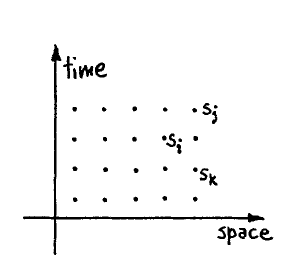

# Análise de Simulating Physics with Computers
>Título: **Simulating Physics with Computers**[^1]  
>Autor: Richard P. Feynman  
>PDF:[Análise de Simulating Physics with Computers.pdf]( <../Pdfs/Análise de Simulating Physics with Computers.pdf>)  

[^1]: Feynman, Richard P.. Simulating Physics with Computers. **International Journal of Theoretical Physics**, vol 21, n. 6/7, 1982. Disponível em: [http://link.springer.com/10.1007/BF02650179](https://rdcu.be/VuhnUWV968Ta). Acesso em 16 de setembro de 2026.
## Resumo
Dentro da computação tradicional, a discretização do mundo real é necessária para que os computadores comuns consigam fazer previsões e simulações do mundo físico, ou seja, para que um computador consiga fazer qualquer tipo de simulação física, deve-se assumir que a Humanidade saiba de todas as Leis Físicas e que seja possível implementa-las. Entretanto, quando se trata de simular o mundo físico em sua totalidade, a computação tradicional afirma que não é possível que uma única máquina consiga fazer tal façanha.

Feynman propõe um experimento mental para descobrir qual tipo de computador conseguiria simular a Física. Inicialmente, ele discute sobre qual Física deve ser simulada: a Física Clássica ou a Física Quântica, reforçando que, neste experimento, o computador deverá ser capaz de simular _**exatamente**_ a Natureza, não apenas chegar à aproximações de como ela se comporta. Isso implica que tudo dentro de um volume finito de tempo e espaço precisa ser capaz de ser analisado com um número finito de operações lógicas, o que é impossível segundo as teorias físicas atuais, que tratam o espaço e suas medidas como capazes de ser infinitesimalmente pequenos ou infinitamente grandes. Dessa forma, chega-se a conclusão que é necessário que aja uma mudança nas Leis Físicas e tem-se já uma sugestão do que poderia ser feito para alterá-las: considerar o espaço como uma rede simples e discreta e que o tempo passa descontinuamente. 

Feynman, então, sugere que imaginemos como seria um mundo físico que segue essa "nova" lei física e cita alguns dos problemas que surgem com essa mudança para a simulação computacional que é o fato que a velocidade da luz se tornaria ligeiramente dependente na direção e a possibilidade de existir outras anisotropias na Física aparentes em experimentos, ainda que pequenas. Como o conhecimento físico sempre será incompleto, ser capaz de prever algo consistentemente a partir de todos dados conhecidos e sugerir um novo fato ainda não explicado é algo bom, mas a questão não é se existe anisotropias nem se poderíamos fazer algum experimento para preve-las, mas sim quão anisotrópico o espaço é. Independente de quanto seja suposto, o experimento com o átomo de lítio sugere que o verdadeiro nível de anisotropia é menor do que o esperado.

Outra sugestão feita foi que as Leis Naturais são reversíveis, enquanto as leis computacionais não, o que não é verdade. As leis computacionais podem ser reversíveis, algo muito útil, especialmente no estudo das relações entre as leis da computação e as leis físicas, abrindo a possibilidade de nos mostrar algo novo em ambas as áreas.

O autor propõe outra regra para esses computadores, além de ser capaz de simular perfeitamente o mundo físico, o tamanho real dessas máquinas deve ser proporcional ao tamanho do espaço-tempo simulado. "Se dobrar o volume do espaço e tempo significa que eu preciso de um computador _exponencialmente_ maior, eu considerarei contra as regras (...).", segundo ele.

A primeira simulação que ele propõe é a simulação do tempo. Ele assume o tempo como discreto (já que não temos como medir com precisão infinita), em uma escala de $10^{-27}$ segundos – maior intervalo de tempo que não causa discrepâncias com os dados experimentais. Na simulação tradicional, como em um autômato celular, o computador varia de estado em estado, o que envolve conceitos de tempo, ainda que intuitivos, ou seja, o computador imita a passagem de tempo ao invés de simulá-la. O autor então questiona se seria possível simular o tempo e não apenas imitá-lo, sugerindo que usemos a visão de espaço-tempo, com todos os pontos do espaço e do tempo já "plotados", gerando mais uma regra para o "computado": Existe um estado $s_i$ para cada ponto $i$ do espaço-tempo, em que $s_i$ é uma função $F_i (s_j,\ s_k, ...)$ dos estados dos pontos $\{j,\ k, ...\}$ nas redondezas de $i$:

$$Fig\ 1:\ s_i = F_i (s_j,\ s_k, ...)$$

Entretanto, se, nesta função, o valor de $s_i$ for dependente apenas de alguns pontos localizados antes do tempo $i$, isso seria um autômato celular normal, já que ela calcula um ponto a partir de pontos anteriores. Feynman pede para que consideremos um tipo mais abrangente de computadores, já que a função real pode ser mais geral, como no caso de uma generalização maior de interligação de pontos do espaço-tempo, por exemplo, o $F_i$ depender de todos os pontos no passado e no futuro. Ele cita esse exemplo porque múltiplas equações matemáticas podem ser simplificadas se considerarmos que os elétrons e os pósitrons possam voltar no tempo e que outras coisas que conectem objetos avancem ou voltem no tempo. Isso levanta a questão de se existiria um algoritmo capaz de ser resolvido – ou seja, computadorizado – caso tal computador seja projetado. Se supormos que a função $F$ é conhecida e é função das variáveis no passado e no futuro, pode ser que não seja possível achar números que a satisfaçam. No caso do autômato celular, a $F$ tem raiz, porque a partir de uma linha é possível achar a próxima e a seguinte e assim por diante de forma organizada, mas o autor incentiva questionar se existiriam circunstâncias em que $F$ não fosse notável, ou seja, que não seja facilmente organizada de forma clara, talvez apenas reduzindo-a à uma aproximação, que o autor chama de "um outro tipo interessante de computação".

Um dos participantes pergunta se isso não reduziria a função à um [problema de valor de contorno](<../Conceitos/Cálculo/Problemas de Valor de Contorno.md>) ao invés de um [problema de valor inicial](<../Conceitos/Cálculo/Problemas de Valor Inicial.md>) como proposto inicialmente, e Feynman responde que reduziria, mas reforça que, no momento, ele está descrevendo o próprio computador. O autor continua, afirmando que a física clássica parece ser causal, sendo possível – a princípio – calcular o futuro a partir de informações do passado, desde que sejam incluído ambos momento e posição ou a posição em dois momentos diferentes no passado, sendo necessário duas informações para cada ponto. Diante a isso, Feynman conclui que a física clássica aparenta ser local, causal e reversível e, por isso, adaptável para simulações computacionais e que não teríamos problemas com isso (se desconsiderar a natureza discreta já discutida no começo).

O autor, então, começa a abordar a questão da [Mecânica Quântica](<../Conceitos/Mecânica Quântica.md>), que nos limita a apenas prever probabilidades. Ele comenta que sempre tivemos dificuldades em entendera visão de mundo que a mecânica quântica representa, ou que pelo menos ele sempre teve essa dificuldade, já que, para o autor, ainda não se tornou óbvio que não há nenhum problema real com esse ponto de vista. Ele suspeita que não há nenhum problema, já que ele não consegue definir um, mas diz que não tem certeza disso e que é por isso que ele gosta de investigar coisas. Feynman pergunta aos ouvintes se seria possível aprender algo com essa pergunta sobre computadores, sobre esse possível mistério do que seria a visão de mundo da mecânica quântica. Então, já que esta parece envolver [Probabilidade](<../Conceitos/Probabilidade e Estatística/Introdução à Probabilidade.md>), o autor decide começar a discutir sobre simular Probabilidade. 

Feynman comenta que uma das formas de fazer um computador simular teorias probabilísticas seria calculando a probabilidade e interpretar o resultado para que ele represente a natureza. Ele usa o exemplo de uma partícula com probabilidade $P(x,\ t)$ de estar na posição $x$ no tempo $t$, em que um caso típico disso que poderia satisfazer uma equação diferencial é o de uma partícula se difundindo:

$$
\frac{\partial P(x,\ t)}{\partial t} = - \nabla ^2 P(x,\ t)
$$

Poderia-se, então, discretizar o $x$ e o $t$ e talvez a própria probabilidade e resolver essa equação como se resolveria qualquer outra [equação parcial multipla](<../Conceitos/Cálculo/Equações de Campo.md>) e fazer um algoritmo exato para ela por discretização. O autor comenta que, primeiramente, existe um problema ao discretizar probabilidade, uma vez que usar apenas $k$ dígitos implica que quando a probabilidade de algo acontecer for menor que $2^{-k}$, considera-se que ela simplesmente não ocorre. Na prática, costuma-se fazer isso, pois