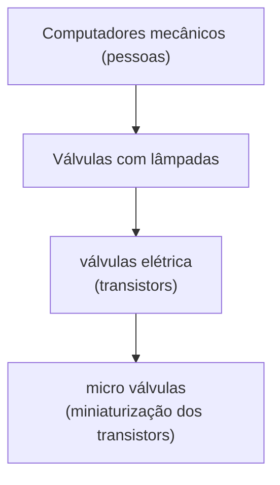

# Computação Quântica Unifor
> Palestra por Paulo Henrique Pereira Silva [^1]  
> PDF: [Computação Quântica Unifor](<Pdfs/Computação Quântica Unifor.pdf>)  
> Slide:   

#palestra

[^1]: SILVA, PAULO HENRIQUE PEREIRA; LIMA, KAROLINE RODRIGUES. **Computação Quântica Unifor**. Universidade de Fortaleza, Fortaleza, CE, 30 set. 2026.
## Grupo de estudos

grupo de estudos sexta 15h30 a 17h no bloco i na sala i-16
Aplicar a computação quântica a favor da humanidade
## Evolução da informatica

## Limitações da computação clássica
- Logica irreversível (perda de informação)
- Perda de energia vinda da dissipação de calor e da perda de energia
## Computação quântica

- As portas logicas são reversivas
- Não ha perda de energia, devido a preservação de informação
- Cada uma das portas logicas são operações de matrizes

O equivalente de um bit é o qBit, que é um comportamento de uma partícula subatômica cujos estados é um ou outro (spins – cima ou baixo –)

# Hardware

## Fenômenos usados
- Dualidade onda-partícula
	Muda dependendo do experimento
- Probabilidade na Quântica
	- Principio de Incerteza de Heisenberg
	Se a velocidade é conhecida, a posição é desconhecido. Se a posição é conhecida, a velocidade é desconhecida
	- Modelos Atômicos
	Agora o elétron é visto como uma nuvem de probabilidade
- Superposição
- Emaranhamento
	Partículas tem o mesmo estado se elas estão emaranhadas

## Tipos de Arquiteturas
- Ion aprisionados
	- Ex: *IonQ*, *Quantinuum*
	O spin é o qBit (variação cima baixo) e a mudança é induzida por lasers.
	Não requer baixas temperaturas
	Necessita de Isolamento de vibrações e eletromagnético
- Fotônica
	- Ex: *PsiQuantum*
	O qBit são os fótons(?) e a mudança é induzida por lasers
	Não depende de temperatura ou vibração.
	Necessita de isolamento eletromagnético
- Super condutores
	- Ex: todos os outros

## Panorama Atual
- Corrida tecnológicas (entre empresas e entre governos)
- Apenas dois grupos no Ceara (GIQ - UFC, computadores "baratos")