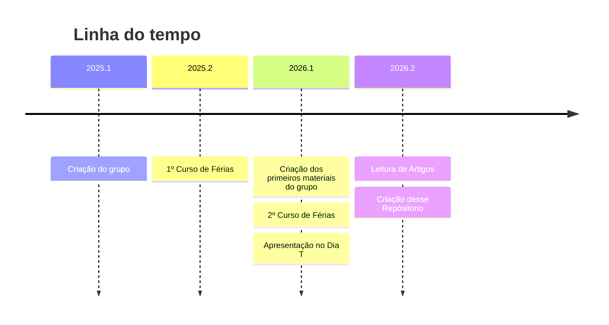

# NQU - Núcleo Quântico Unifor

O Núcleo Quântico Unifor (NQU) é um Grupo de Estudos da Universidade de Fortaleza (Unifor) de [Computação Quântica](<Computação Quântica.md>) liderado pelo Professor Paulo Henrique Pereira Silva.

## Sobre este repositório
Este repositório esta sendo produzido para servir de guia para novos alunos que visam entrar no NQU ou apenas acompanhar o estado do grupo e o que estamos fazendo, além de permitir que o conteúdo e os trabalhos dos grupos sejam mais facilmente encontrados pelos integrantes do grupo.

Atualmente o repositório está sendo mantido apenas por mim, mas ao deixar o repositório público espero que outros alunos consigam pegar a frente desse projeto e continuar o atualizando mesmo após a minha formatura.

Futuramente, estamos estudando a possibilidade de torná-lo uma pequena wiki do próprio grupo.

